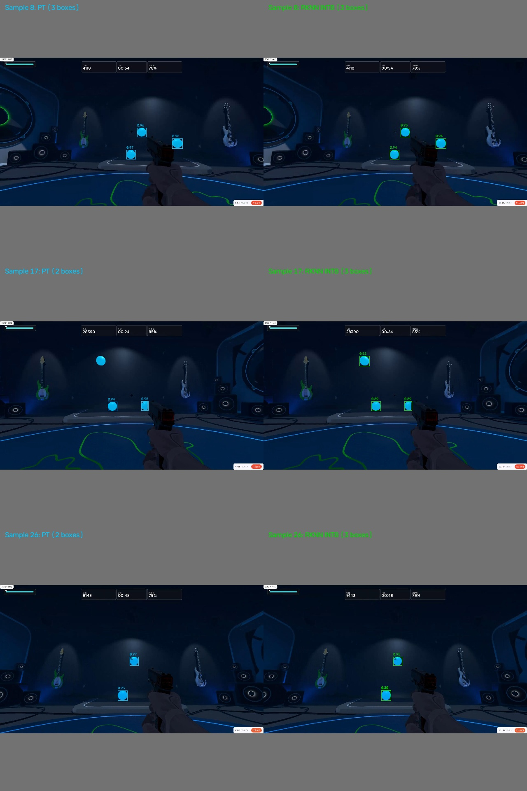

# v3：RK3588 多核 NPU、内存优化与 YOLO26n 640×640 实验

实验日期：2026-11-13。这个版本记录两轮连续实验：先比较 YOLO26n 320×192、RTMDet-tiny 256×160 的 NPU 核调度与内存处理，再新训练一个 YOLO26n 640×640，用同一批视频画面重复测试。

**v3 是模型和性能实验归档，没有替换 v1 的 HDMI 识别与鼠标控制程序。** 此次整理没有重新训练或连接板子，也没有删除原项目或改动 v1、v2。

## 1. 先看结论

- 640模型在RK3588上，单核执行一个实例的单帧延迟，比两核/三核联合更低；三份模型的单核都优于已测的三核联合配置。小分辨率模型没有测试双核联合，不外推这一结论。
- 多个实例分别使用单核，可以提高总吞吐量，但会增加每帧的等待时间。高 FPS 不等于低延迟。
- YOLO26n 640×640：单实例约 **47.8 FPS / 20.83 ms**；三个实例约 **126.7 FPS / 23.55 ms**；六个实例约 **148.1 FPS / 40.27 ms**。
- 640 的十二实例仅比六实例快 **0.32%**，单帧延迟却接近翻倍，当前条件下没有采用价值。
- 640 的主要内存优化收益来自**前处理缓冲区复用**。单独预分配模型输出只提高约 0.6%。
- 当前小球控制任务更值得优先保留 320×192。640 输入改善定位细节的可能性，需要与明显增加的延迟一起考虑，不能只看最高吞吐量。

## 2. 文件怎么找

```text
v3/
├─ README.md
├─ src/                         训练、转换、板端测速、验证与汇总代码
├─ weights/
│  ├─ yolo26n-640x640/           新训练的 best.pt、ONNX、INT8 RKNN
│  ├─ yolo26n-320x192/           本轮实际测试的 Toolkit2 2.5 INT8 RKNN
│  └─ rtmdet-tiny-256x160/       修复置信度后的 MMSE INT8 RKNN
├─ data/
│  ├─ video_frames.npz/.json    同一批 24 张原尺寸视频帧及来源/校验信息
│  └─ validation640/            36 张输入、PT 原始输出及检测框参考
└─ results/
   ├─ summary/                 全部实验的统一 CSV/JSON 总表
   ├─ multicore-small/          320×192、256×160 多核/IO原始采样与日志
   ├─ multicore640/             640 基线、优化、IO对照的原始采样与日志
   ├─ validation640/            上板输出验证、真实标签复核、对照图
   ├─ validation-io/            预分配、整数输出、DMA 的一致性检查
   ├─ training640/             50轮训练曲线数据、参数、实际形状、指标
   ├─ conversion640/           导出/量化参数、校准图选择清单与转换日志
   ├─ model-build/             320模型构建信息、RTMDet量化修复摘要
   ├─ archive-sources.json     原始文件位置及原始SHA256
   └─ archive-manifest.json    本归档文件大小/SHA256和整理时的验证结果
```

先看 `results/summary/all-results.csv`。需要核对某一次采样时，再进入两个 `multicore` 目录查看 JSON；JSON 内保留每帧耗时、帧编号、实例编号、运行频率和温度。

没有重复保存完整训练图片、原 MP4、`last.pt`、虚拟环境、SDK、驱动、下载缓存或临时文件。为了可以直接复测，保留了 24 帧的无损压缩缓存，以及 640 转换验证输入；不用再读取完整视频。160 张量化校准图可以由导出脚本根据原训练集重新生成，选择清单和源图哈希已留档。

初始预训练权重和通用固定尺寸训练器继续复用 `../v2/weights/yolo26n.pt`、`../v2/compare_resolutions.py`。**板端测速不依赖 v2；重新训练/导出需要保留 v2 和原始数据集。** v2 的 RKNN 是早期 Toolkit2 2.3.2 产物，不要拿它替换本次实测的 2.5 模型。

## 3. 测试环境与计时边界

| 项目 | 本次条件 |
| --- | --- |
| 板卡 | ATK-DLRK3588，8 GB RAM / 64 GB eMMC |
| 板端系统 | 当前官方 Buildroot，Linux 6.12.69；不是此前 Task E 的 7.3.1 系统 |
| Runtime / 驱动 | RKNN Runtime 2.5.0 / RKNPU 驱动 0.9.8 |
| 板端 Python 库 | Python 3.14.5、NumPy 2.4、OpenCV 4.13 |
| 模型 | batch=1，固定输入尺寸，INT8；每个并发实例独立创建 RKNN context |
| 频率 | NPU 1 GHz、DDR 1.56 GHz，大核 CPU 2.208 GHz |
| CPU 使用 | 工作线程绑定 CPU 4～7，OpenCV 单线程 |
| 测试后状态 | 所有实验记录均显示频率设置恢复成功，最终 NPU 三核负载为 0 |

训练电脑为 RTX 4060 Laptop 8 GB，PyTorch `2.9.1+cu128`、Ultralytics `8.4.204`。640 转换使用已有 WSL 环境中的 RKNN Toolkit2 `2.5.0`。

原视频均为 1920×1080：从 `1.mp4`、`2.mp4` 各抽 4 帧，从 `3.mp4` 抽 16 帧，总共 **24 帧**。缓存文件约 14.2 MB，解开到 RAM 后约 149 MB。测试开始前加载、解压完成，之后重复处理这些帧。

小分辨率五份原始结果共 **121,920 次**；640 三份结果共 **20,640 次**；合计 **142,560 次计时推理**，不含预热。它们不是 142,560 张不同图片，也不是长时间真实视频播放测试。部分输入来自训练视频，因此这组数据用于性能/输出一致性，不作为独立精度测试集。

```text
已解码、位于内存的1080p BGR画面
  → 等比例缩放和补边、RGB转换
  → RKNN输入准备、执行、取输出
  → 检测头解码，得到原画面坐标检测框
```

- `full`：包含常规前处理和最终检测框。
- `reuse`：包含前处理，但复用缩放/补边/RGB缓冲区；检查过与原前处理逐像素一致。
- `rgb`：RGB输入提前准备，省略前处理；不能与 `full` 当成同一口径。
- **不计入** eMMC读取、MP4解码、HDMI采集、绘制显示或鼠标控制。
- 每个实例先预热 20 次；轮次正反顺序交替。所有测量帧均与该输入的单实例参考框比较，检查帧编号无缺失、无重复。
- FPS 用“完成帧数÷整轮墙钟时间”计算；合并轮次时分别累加帧数和总时间。单帧延迟从这帧开始前处理算到生成框。输出一致性检查不计入单帧延迟，但会影响整轮吞吐。
- `rknn_run_ms` 是同步 API 调用时间，并发时包括 Runtime 内部调度/等待，**不是独立硬件算子执行时间**。

三个模型的尺寸、结构、后处理不同，跨模型表表示这些具体部署候选的表现，不能据此单独证明哪种架构更优。

## 4. 多核是什么意思

RK3588 有三个 NPU 核。`core_mask` 中，`1`、`2`、`4` 分别表示只使用核0、核1、核2；`3` 表示一个模型联合使用核0和核1；`7` 表示一个模型联合使用三个核。

| 配置 | 含义 |
| --- | --- |
| `1` | 一个实例，只使用一个核 |
| `3` / `7` | 一个实例联合使用两个/三个核 |
| `1,2,4` | 三个独立实例，各占一个核，处理不同帧 |
| `1,2,4,1,2,4` | 六个实例，每核两个 |
| 十二个mask | 每核四个实例 |

每个实例同时只处理一帧，处理完再取下一帧；程序没有额外的待处理帧队列。但同一个核上多个实例仍可能在 Runtime 内部等待。

例如六实例 148 FPS，只表示每秒总共完成约148帧，不能倒推出单帧延迟是 `1000/148=6.8 ms`。实测每帧仍约40 ms。用于控制鼠标时，旧帧到达的时间和单帧延迟同样重要。

## 5. YOLO26n 640×640：训练与转换

新模型从与 v2 相同的 `yolo26n.pt` 独立开始，未接着320模型微调。单类别 `ball=0`；视频1、2共607张训练图，视频3共300张验证图。验证集用于选模型，不是额外保留的最终测试集。

50轮、batch16、seed42、AdamW、初始学习率0.001、AMP，关闭早停和mosaic/mixup/cutmix；轻量增强与 v2 保持一致。通过固定 `batch_shapes` 并断言实际张量，确认是 `[16,3,640,640]`。训练用时 **992.85秒，约16.5分钟**。

| 原训练验证路径的FP32指标 | 结果 |
| --- | ---: |
| Precision | 99.886% |
| Recall | 99.631% |
| mAP50 | 99.500% |
| mAP50–95 | 97.582% |

以上来自训练后显式 FP32 验证，不是INT8全验证集mAP，也不是游戏命中率。训练验证路径与下面导出的one-to-one检测头要分开记录。

转换步骤：

1. 明确选择训练好的 **one-to-one** 检测头，再融合模型。导出三个stride下的回归/分类，共6个原始输出；`reg_max=1`，没有DFL解码，不做NMS，最多保留300个候选。
2. Windows导出静态 ONNX，opset12、输入 `[1,3,640,640]`。在24帧视频和12张验证图上检查 PT官方输出、自定义解码和ONNX输出，原始输出最大绝对误差约 `0.0001866`。
3. 从训练集以seed42选160张校准图；等比例缩放、居中114补边，与推理一致。RKNN输入为 RGB uint8 HWC，mean0/std255放在模型里，调用端不再次除以255。
4. Toolkit2 2.5.0 使用 `asymmetric_quantized-8`、`normal`、optimization3。为绕过已知SDPA融合问题，关闭 `fuse_exmatmul_add_mul_exsoftmax13_exmatmul_to_sdpa` 这一优化规则，没有修改训练权重。记录包含[对应问题来源](https://github.com/airockchip/rknn-toolkit2/issues/581)。
5. 在真实RK3588上验证INT8输出，再进行多核/缓冲区对照。新模型约4.52 MB，PT约5.45 MB，ONNX约9.65 MB。

`export640.json` 中 `board_validated:false` 是导出时的历史状态；后续上板结果在 `results/validation640/board-validation.json`，整理时没有篡改原始记录。

## 6. YOLO26n 640×640：多核结果

下面统一使用 **reuse前处理 + prealloc浮点输出缓冲区**；每种配置2轮，每轮960帧。

| 配置 | 总吞吐 FPS | 单帧平均 ms | P95 ms |
| --- | ---: | ---: | ---: |
| 单核单实例 | 47.77 | 20.835 | 20.871 |
| 两核联合单实例 | 39.28 | 25.360 | 25.527 |
| 三核联合单实例 | 39.57 | 25.170 | 25.359 |
| 三实例，每核一个 | 126.67 | 23.550 | 23.746 |
| 六实例，每核两个 | 148.07 | 40.272 | 40.672 |
| 十二实例，每核四个 | 148.54 | 80.162 | 80.848 |

原始前处理/输出路径的基线分别为：单核40.54 FPS、两核联合34.19、三核联合34.46、三实例107.35、六实例145.61。详细阶段耗时在 `results/multicore640/comparison640.csv`。

单核优化后 `rknn_run` 约17.52 ms，加输入输出、前处理和解码，合计约20.83 ms。联合多核并未加速本模型；分割、同步和调度开销可能参与其中，但本次没有做逐算子分析，不能把推测写成已定位的原因。

## 7. 与前一轮小分辨率一起看

统一取优化路径 `reuse/prealloc`；单实例使用单核，多实例均各自绑定单核。

| 模型与输入 | 单实例 FPS / ms | 三实例 FPS / ms | 六实例 FPS / ms |
| --- | ---: | ---: | ---: |
| YOLO26n 320×192 | 238.42 / 4.114 | 584.30 / 5.034 | 851.19 / 6.919 |
| RTMDet-tiny 256×160 MMSE | 235.33 / 4.168 | 589.83 / 4.995 | 839.85 / 7.026 |
| YOLO26n 640×640 | 47.77 / 20.835 | 126.67 / 23.550 | 148.07 / 40.272 |

RTMDet十二实例约838.31 FPS / 14.17 ms，也未继续增加吞吐。640输入像素为320×192的6.67倍，实测单实例完整处理约慢5.06倍；像素数与耗时不是严格线性关系。

RTMDet这里使用修复后的 **MMSE INT8**，不是此前置信度下降严重的normal INT8。修复摘要保存在 `results/model-build/`。保留这些摘要是为了说明模型选择来源；完整RTMDet训练/量化诊断工程不在本次v3范围。不能从速度表推导它比YOLO精度更高。

## 8. 内存优化实际做了什么

| 640单核路径 | FPS | 平均完整耗时 | 前处理平均耗时 |
| --- | ---: | ---: | ---: |
| 原始处理 | 40.54 | 24.546 ms | 6.080 ms |
| 只预分配输出 | 40.79 | 24.403 ms | 6.066 ms |
| 再复用前处理缓冲区 | 47.77 | 20.835 ms | 2.597 ms |

`prealloc` 让Runtime写到预分配的NumPy浮点输出中，减少反复分配和额外复制。`reuse` 让OpenCV把缩放结果直接写到补边画布的ROI，再写到复用RGB缓冲区。实际检查了所有24帧与基线输入逐像素相同。

主要收益来自前处理。到六实例时，模型执行已接近饱和，继续减少前处理开销只带来有限吞吐收益；更快提交也可能增加 `rknn_run` 内部等待，所以这个字段升高不代表网络本身突然变慢。

前一轮还在RTMDet上比较了整数输出自行反量化与绑定DMA输入输出。**DMA路径仍把RGB复制进DMA内存，不是端到端零拷贝。** 当时六实例的full路径中，DMA约568.06 FPS，低于prealloc约826.30 FPS。它不是在所有情形下都更快；640没有做DMA对照，不把RTMDet结论直接套到640上。

输出缓冲区复用也有生命周期要求：返回数组属于当前模型实例，下次 `run()` 会更新内容，`close()` 后不可继续使用；并发线程各自使用自己的实例，不能共享一份可写缓冲区。

## 9. 精度和正确性检查

640在36张输入上，与PT参考比较得到：PT95框、INT8 98框、94框匹配，匹配框平均IoU **0.98525**，最大中心偏差约 **0.251个640画布像素**。这是小样本一致性检查，不是完整mAP。

进一步核对其中12张验证图的真实标签，共33个球：

| 路径 | 正确检出TP | 多余框FP | 漏检FN |
| --- | ---: | ---: | ---: |
| PT | 33 | 1 | 0 |
| INT8 | 33 | 3 | 0 |

INT8的3个多余框是重复框。相对PT“少的1框”其实是PT的背景误检；另一个视频样本INT8补出了PT没有检出的真实球。因此不能把相对PT的框数差直接当成真实漏检率，也不能写“量化完全无损”。



改变core mask为1/2/3/4/7并使用prealloc后，36张输入的原始输出最大差异为0；全部测速帧的检测输出也通过了参考一致性检查。这里证明的是调度/内存修改没有改变当前输出，不是证明模型没有误检。

## 10. YOLOv5与YOLO26的判断

**本次没有训练或上板测速YOLOv5。** 以下只记录2026-11-13查阅的瑞芯微官方参考数据：RK3588单核、640×640、INT8、模型推理，不含前后处理。

| 规格 | YOLOv5 | YOLO26 |
| --- | ---: | ---: |
| n | 84.6 FPS | 55.0 FPS |
| s | 49.1 FPS | 30.5 FPS |

来源：[RKNN Model Zoo性能表](https://github.com/airockchip/rknn_model_zoo#model-performance-benchmarkfps)。这支持“在该平台官方同级参考里YOLOv5纯推理更快”，不等于本数据集重训后一定保持相同差距。

YOLO26的免NMS输出可以减轻后处理，但网络结构、注意力算子和RKNN映射效率仍影响总速度。实际640导出图包含4个MatMul和2个Softmax；仅凭这些节点不能定量断言它们各占多少毫秒。[YOLO26官方说明](https://docs.ultralytics.com/models/yolo26/)

前面参考的[高速部署仓库](https://github.com/wzxzhuxi/rknn-3588-npu-yolo-accelerate-saturated)使用YOLOv5s_relu、多个NPU实例以及视频/内存流水线优化，不能把其结果写成普通YOLOv5s直接运行的速度。标准YOLOv5也并非默认全用ReLU；ReLU专门版本涉及模型与训练配套。后续若比较，需要同数据、同输入尺寸、同量化条件重训原版YOLOv5n，区分它与YOLOv5u。

## 11. 怎么复现

归档入口只调整路径和命令参数，训练超参、检测解码和核心计时逻辑保留。历史JSON中的脚本SHA与绝对路径属于当时运行环境；`archive-sources.json`记录原件哈希，`archive-manifest.json`记录整理后文件哈希。路径适配经过本地语法、输入与统计检查，**未因整理而重新跑一次完整训练/板端性能测试**。

### 只查看或重新汇总数据

在Windows PowerShell进入本v3目录，用现有Python环境执行；新结果写到新目录，不覆盖历史记录：

```powershell
& 'G:\python-project\linux-project\.venv\Scripts\python.exe' .\src\summarize.py --output-dir .\work\summary-new
```

### 重新训练640

需要保留同级v2目录，以及原来的带标签数据集。下面命令才会实际开始训练：

```powershell
& 'G:\python-project\linux-project\.venv\Scripts\python.exe' .\src\train640.py --data-dir 'G:\python-project\linux-project\project\linux-hdmi-preview\yolo\data' --output .\work\train640-new
```

### 重新转换640

Windows侧导出，依赖原训练数据生成160张校准图，并使用归档24帧缓存做验证；默认读取已归档的640 `best.pt`：

```powershell
& 'G:\python-project\linux-project\.venv\Scripts\python.exe' .\src\export640.py --data-dir 'G:\python-project\linux-project\project\linux-hdmi-preview\yolo\data' --output .\work\convert640-new
```

随后在WSL的本v3目录中，用已有Toolkit2 2.5.0环境构建。脚本重建当前WSL校准图片路径，避免沿用历史路径：

```bash
/home/zzy/rknn320-venv/bin/python src/build640.py --work work/convert640-new
```

不需要重新安装环境或下载另一套SDK。版本不匹配时先核对现有环境；脚本不会自动安装。

### 上板重新测速

把v3目录传到RK3588的一个新目录，保留内部结构即可。依赖板上的NumPy、OpenCV和 `/usr/lib/librknnrt.so` 2.5.0；通过ctypes调用C Runtime，不需要额外安装RKNN Lite2。先停止会占用NPU的识别程序，在板端以root进入v3目录，再执行：

```bash
OPENBLAS_NUM_THREADS=1 OMP_NUM_THREADS=1 python3 src/board_benchmark.py \
  --model weights/yolo26n-640x640/model-int8.rknn \
  --family yolo --width 640 --height 640 \
  --frames 960 --rounds 2 --warmup 20 \
  --configs '1;3;7;1,2,4;1,2,4,1,2,4;1,2,4,1,2,4,1,2,4,1,2,4' \
  --modes reuse --io prealloc --output work/640-retest.json
```

对照原始路径用 `--modes full --io baseline`；只测预分配输出用 `--modes full --io prealloc`。替换成YOLO320时改模型路径和尺寸；测试RTMDet时改 `--family rtmdet --width 256 --height 160`，并选择对应MMSE权重。

该脚本会临时调整CPU/NPU/DDR频率，正常结束、Ctrl+C或SIGTERM时尝试恢复并记录结果；断电或强制kill无法保证执行清理。它不会启动HDMI或控制鼠标。

640板端输出一致性验证：

```bash
python3 src/validate640.py --output work/640-validation-new.json
```

RTMDet三种IO接口的正确性检查（每次换输出文件名）：

```bash
python3 src/io_smoke.py prealloc --output work/io-prealloc-new.json
```

`prealloc`可换为`quantized`或`dma`。不改模型、只改取输出方式；先保证输出一致再测速。

如果想重新从视频抽样，使用 `src/extract_video_inputs.py --video-dir <原视频目录> --output-dir <新目录>`，随后给benchmark指定 `--inputs <新目录>/video_frames.npz`。已有缓存足够复现本次测试，无需重复复制原视频。

## 12. 当前完成到哪里

已完成：640独立训练、静态ONNX与INT8转换、真实板端输出检查、多核/多实例/内存对照，以及原始数据归档。

尚未完成：把这些优化接入实际HDMI识别和鼠标闭环；完整INT8验证集精度测试；同条件YOLOv5训练对比；证明高并发下新帧选择策略能降低真实控制延迟。

下一步若继续做控制工程，先选择320×192与适当并发数，接入后测“采集时间戳→检测完成→鼠标动作”的实际延迟；不要把缓存帧吞吐表直接写成整个系统的实时帧率。
